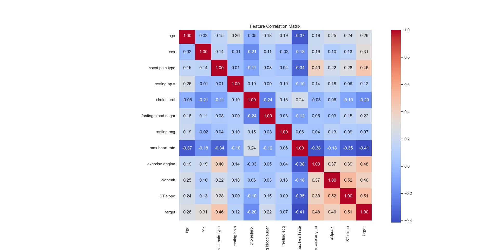
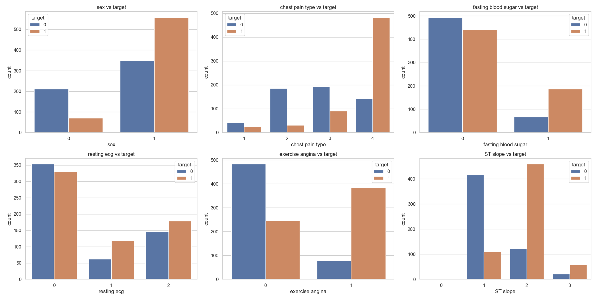

# 心脏病预测：MLP 与残差全连接网络的对比

> 深圳大学《深度学习》课程设计 · 2024 年春季学期
> 指导教师：黄若冰 · 作者：江浩天（22 级生物医学工程创新班）

基于 1190 例患者的结构化临床数据做心脏病二分类预测，先完成数据探索与特征工程，再实现并对比两个模型：**MLPNet**（三层前馈网络基线）与 **ResFCNet**（引入残差连接的全连接网络）。

---

## 结果速览

| 模型 | Accuracy | Precision | Recall | F1 | AUC |
| --- | --- | --- | --- | --- | --- |
| MLPNet | 87.82% | 88.80% | 88.10% | 88.45% | 93.63% |
| **ResFCNet** | **88.24%** | **89.52%** | 88.10% | **88.80%** | **94.01%** |

测试集（238 例）混淆矩阵：

| 模型 | TN | FP | FN | TP |
| --- | --- | --- | --- | --- |
| MLPNet | 98 | 14 | 15 | 111 |
| ResFCNet | 99 | 13 | 15 | 111 |

两个模型在召回率上完全一致（88.10%，约 12% 的患者被漏诊），ResFCNet 的优势体现在**少一个假阳性**以及更高的 Precision / F1 / AUC——提升幅度很小，属于“结构更复杂但收益有限”。

---

## 数据集

`heart_statlog_cleveland_hungary_final.csv`：由 Cleveland、Hungary 等来源的 statlog 心脏数据整合而成，**1190 例患者、11 个特征 + 1 个二分类标签**，随仓库一并提供（数据集说明见 `docs/数据集说明.pdf`）。

| 类型 | 特征 |
| --- | --- |
| 数值型 | `age`、`resting bp s`、`cholesterol`、`max heart rate`、`oldpeak` |
| 二元型 | `sex`、`fasting blood sugar`、`exercise angina`、`target`（1 = 患病） |
| 名义型 | `chest pain type`(1–4)、`resting ecg`(0–2)、`ST slope`(1–3) |

样本层面：年龄 28–77 岁（均值约 54），男性约 76.4%，阳性样本约 52.9%——目标变量本身基本平衡。

数据探索结论（`data_v.py`）：

| 单变量与目标的关系 | 相关系数 |
| --- | --- |
| ST slope | 0.51 |
| exercise angina（运动诱发心绞痛） | 0.48 |
| chest pain type | 0.46 |
| max heart rate | **−0.41** |

| 特征相关系数热图 | 类别特征 vs 标签 |
| --- | --- |
|  |  |

---

## 方法

### 特征工程（`preprocess.py`）

基于 EDA 中的三个观察新增三个特征：

| 新特征 | 计算方式 | 动机 |
| --- | --- | --- |
| `heart_reserve` | `220 − age − max heart rate` | 最大心率与患病负相关（−0.41），但受年龄影响，心率储备比原始心率更能反映心脏功能 |
| `high_risk_cp` | `chest pain type == 4` | 4 型（无症状）胸痛与心脏病高度相关，单独抽出为二元特征 |
| `bp_age_ratio` | `resting bp s / age` | 血压随年龄自然升高，比值可衡量血压是否与年龄匹配 |

同时把医学上不合理的 `cholesterol <= 0` 视为缺失值（置为 `NaN`），交由管道填充。

### 预处理管道

```
数值型：SimpleImputer(median) → PowerTransformer(yeo-johnson) → RobustScaler
类别型：OneHotEncoder(drop='first')
```

中位数填充抗异常值；Yeo-Johnson 幂变换把偏态分布（如胆固醇）拉近正态；RobustScaler 用四分位距缩放，对离群点不敏感；one-hot 丢弃首列避免共线性。划分采用**分层抽样**（`stratify=y`，8 : 2，`random_state=42`）。

### 模型

**MLPNet**（基线）：

```
Linear(input, 128) → BatchNorm → SiLU → Dropout(0.3)
Linear(128, 64)    → BatchNorm → SiLU → Dropout(0.3)
Linear(64, 1)      → Sigmoid
```

**ResFCNet**（进阶）：输入先升到 64 维，接两个 `ResidualBlock`，每块内部为 `Linear(64,64) → BN → ReLU → Dropout(0.2) → Linear(64,64) → BN`，再与残差支路相加后 ReLU；末端 `Linear(64,1) + Sigmoid`。残差恒等映射缓解了梯度消失，使网络可以学习特征的**增量修正**而非整体重学。

### 训练配置

| 项目 | 设置 |
| --- | --- |
| 优化器 | Adam，lr = 1e-3 |
| 损失函数 | BCEWithLogits 风格的 `BCELoss`（模型输出已经过 Sigmoid） |
| Batch size / Epochs | 32 / 30 |
| 早停 | 监控验证损失，`patience=5`、`delta=0.001` |
| 正则化 | BatchNorm + Dropout（MLP 0.3 / ResFCNet 0.2） |

---

## 数据处理改进（消融）

`docs/数据处理改进.docx` 记录了预处理前后的对比实验。改进后的结论是：

- **MLPNet 受益最明显**——几乎所有指标都提升，Precision 提升 **+4.59 个百分点**；
- 两个模型的性能差距缩小，说明在样本量有限的医疗表格数据上，**好的预处理可能比更复杂的架构更重要**；
- ResFCNet 的收益主要来自更稳健的预测分布（假阳性 14 → 13）。

改进前后的可视化对比存于 `docs/figures/改进前/` 与 `docs/figures/改进后/`。

---

## 目录结构

```
heart-disease-mlp-resfcn/
├── main.py             # 入口：加载数据 → 训练两个模型 → 可视化 → 保存权重
├── preprocess.py       # 异常值处理、特征工程、预处理管道、分层划分
├── train_eval.py       # 训练循环 + 早停 + Accuracy/Precision/Recall/F1 评估
├── model_mlp.py        # MLPNet
├── model_resnet.py     # ResidualBlock / ResFCNet
├── utils.py            # EarlyStopping、模型保存/加载
├── visual.py           # 混淆矩阵、ROC 曲线绘制
├── data_v.py           # 数据探索与可视化（EDA）
├── heart_statlog_cleveland_hungary_final.csv
├── mlpnet_model.pth / resfcnet_model.pth / heart_preprocessor.pkl   # 训练产出
└── docs/
    ├── 课程设计报告.doc      # 完整实验报告
    ├── 数据处理改进.docx     # 预处理改进的对比与分析
    ├── 答辩讲稿.docx / 答辩PPT.pptx
    ├── 数据集说明.pdf
    └── figures/              # EDA 图、改进前/后对比图
```

---

## 快速开始

```bash
pip install -r requirements.txt

python data_v.py    # 可选：数据探索与可视化
python main.py      # 训练 MLPNet 与 ResFCNet，打印指标并保存权重
```

`main.py` 以相对路径读取同目录下的 `heart_statlog_cleveland_hungary_final.csv`，请在仓库根目录运行。训练产物（`*.pth`、`heart_preprocessor.pkl`）会写回当前目录，仓库中已附带一份训练结果可直接加载：

```python
from preprocess import load_and_preprocess
from utils import load_model
from model_resnet import ResFCNet

X_train, X_test, y_train, y_test, preprocessor = load_and_preprocess(
    'heart_statlog_cleveland_hungary_final.csv'
)
# 特征维度由 one-hot 后的实际列数决定，当前数据为 19 维
model = load_model(ResFCNet, input_dim=X_train.shape[1], path='resfcnet_model.pth')
```

---

## 结论与局限

- **残差结构带来的提升很小**（Acc +0.42pp，AUC +0.38pp），在 1190 例的表格数据上，模型容量并非瓶颈；样本量与特征质量才是。
- 两个模型都漏诊约 12% 的阳性患者，若用于真实筛查场景需要按临床代价重新调整决策阈值，而不能停在 0.5。
- 早停依据的是测试集损失（原实现如此），这会让测试集信息渗入训练过程，报告的指标存在**乐观偏差**；更严谨的做法是从训练集再切一份验证集。
- 可继续尝试：SMOTE 等过采样、梯度提升树（XGBoost / LightGBM）作为强基线、模型集成，以及注意力机制带来的可解释性。

*本项目为本科课程作业，模型与结论仅用于教学演示，不构成任何医疗诊断依据。*
